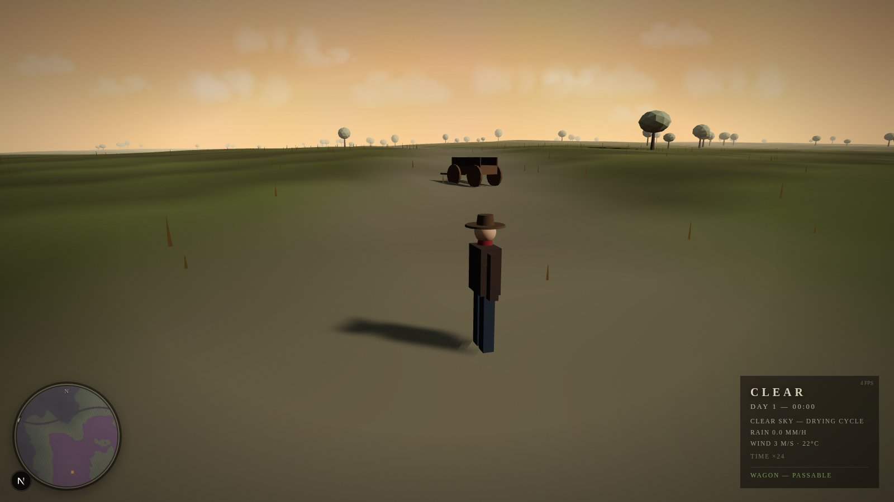
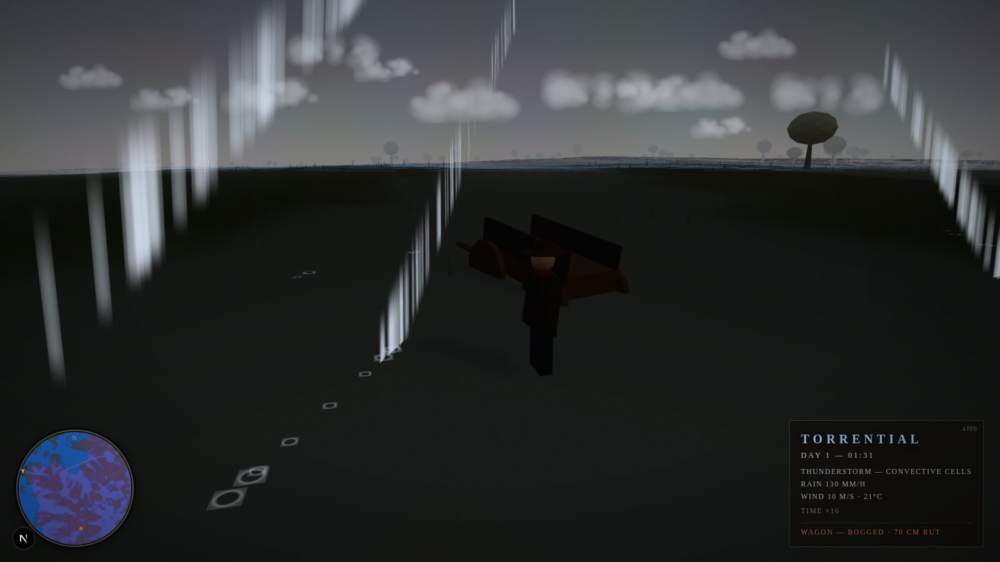
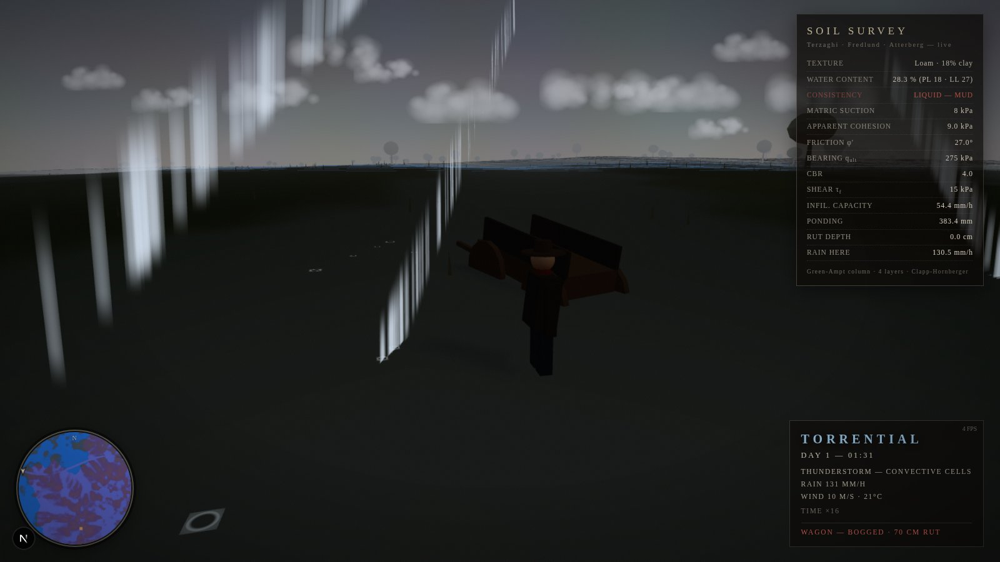

# Stormcountry — the playable 3D layer

A third-person, RDR2-flavoured weather sandbox built on the **same physics as the
Python `rwengine`** in this repository. You run around a 768 m synthetic
catchment while a real storm passes over you: rain hammers down with a
Marshall-Palmer drop spectrum, the ground infiltrates it with Green-Ampt,
puddles pond in the lows, the dirt road liquefies — and the wagon parked on it
sinks to its axles. Your own boots feel it too: wet clay slows you, liquid mud
swallows you half a metre and you leave ruts behind.


*Clear Sky preset — golden hour over the valley road.*


*Thunderstorm peak — 135 mm/h, the wagon is BOGGED with a 70 cm rut.*


*The soil inspector (E) — live Terzaghi / Fredlund / Atterberg column survey under your feet.*

---

## Quick start

Requires Node 18+ (or [Bun](https://bun.sh)):

```bash
cd game
npm install         # or: bun install
npm run dev         # or: bun run dev
# open http://localhost:3000, click to lock the mouse, walk with WASD
```

No other setup: the five weather timelines are bundled in `public/weather/`.

## Controls

| key | action |
|---|---|
| click | start / mouse-look (pointer lock) |
| `W A S D` | move (camera-relative) |
| `Shift` | sprint |
| `Space` | jump (a pathetic hop when bogged) |
| mouse wheel | camera zoom |
| `E` | soil inspector — live column survey at your feet |
| `T` | cycle time scale (1× … 64×) |
| `1`–`5` | switch scenario: clear sky, drizzle, thunderstorm, cold front, monsoon |
| `G` | cycle graphics quality (LOW / MEDIUM / HIGH / ULTRA) |
| `C` | cinematic letterbox |
| `M` | mute procedural audio (rain, wind, thunder) |

## What is actually simulated

Everything you see happening to the ground is a real-time port of the
`rwengine` physics (192×192 cells at 4 m, 30 Hz render / fixed-step sim):

| system | model |
|---|---|
| rainfall forcing | per-minute timelines extracted from the reference `rwengine` runs (`tools/extract_weather.py`) |
| drop microphysics | Marshall-Palmer DSD → median drop size & Gunn-Kinzer fall speed drive the rain renderer |
| infiltration | Green-Ampt with wetting-front suction, ponding head and raindrop kinetic-energy crusting |
| soil column | 4 layers, Clapp-Hornberger `K(θ)` percolation, bulk-aerodynamic evaporation |
| surface water | depression storage → puddles (visible, with rain ripples) + D8 Manning runoff routing |
| strength | matric suction → Fredlund apparent cohesion → Mohr-Coulomb → Terzaghi `q_ult`, CBR |
| consistency | Atterberg states (solid / plastic / liquid-mud) with softening past the liquid limit |
| trafficability | punching-shear rutting: the wagon re-loads the road every 3 s and leaves 70 cm ruts in liquid ground; your sprint churns ruts too |
| contact (prints) | a 16 m micro-relief window at 6.25 cm carries real geometry, not decals: boot-anatomy prints (ball + deeper heel, arch untouched), volume-conserving squeeze-out lips, peel-out suction that flings lumps behind the toe and cakes your boots, sole smears that dry out on firm ground |

The scripted story matches the reference Python run: **thunderstorm turns the
valley 37% mud, `q_ult` collapses from ~450 to ~200 kPa, and the wagon goes
PASSABLE → MARGINAL → BOGGED**. Press `3`, hit `T` until 64×, and watch it
happen.

## Performance

Target device: MacBook Air M1 base (8-core GPU, fanless) at 30 fps.

* fixed 30 Hz simulation step decoupled from the render loop (spike-guarded)
* auto quality scaler: a 5 s FPS EMA steps between LOW…ULTRA
  (grass 14k→52k instances, rain 1.6k→5.6k streaks, pixel ratio 0.9→1.5,
  shadow map 1024→2048); `G` overrides it manually
* one instanced draw call each for grass, rain, splashes, trees, rocks;
  terrain shading (wetness / ponding / mud / road) is a single `DataTexture`
  updated in place; prints and ruts are displacement in a 16 m micro-relief
  window — no footprint decals anywhere
* ACES tone mapping, exponential fog doubles as the draw-distance control

## Code layout

```
src/
  app/                 Next.js 16 shell (one page, no other deps)
  components/          GameCanvas.tsx — mounts the engine into the DOM
  game/
    engine.ts          orchestrator: fixed-step loop, presets, quality, QA hook
    terrain.ts         same Gaussian catchment recipe as rwengine state.py
    params.ts          soil texture tables + presets (ported from config.py)
    ground.ts          Green-Ampt, routing, full geotech chain (the physics)
    contact.ts         16 m micro-terrain: boot prints, ruts, spade work, spoil
                       relaxation — volume-conserving soil deformation
    weather.ts         timeline playback + lightning scheduling
    world.ts           terrain mesh, sky, clouds, grass, trees, rocks, wagon
    fx.ts              rain streaks, splashes, puddles, procedural audio
    player.ts          third-person rider, mud mechanics, boot-mud pickup/shed, camera
    hud.ts             minimap, weather panel, inspector, cinematic overlays
tools/extract_weather.py   regenerates public/weather/*.json from rwengine
```

Debug hook: after boot, `window.__game.fastForward(minutes)` runs the ground
physics forward; `window.__game` exposes the live engine for scripting.

## Regenerating the weather timelines

The five `public/weather/*.json` files are extracted from the **actual
reference runs** of the Python engine (CSVs in `../outputs/`, plus headless
runs for clear_sky / cold_front). After changing the Python engine:

```bash
python tools/extract_weather.py      # needs numpy + pandas
```
